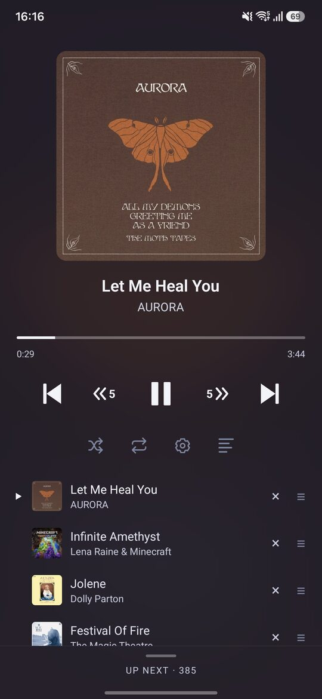
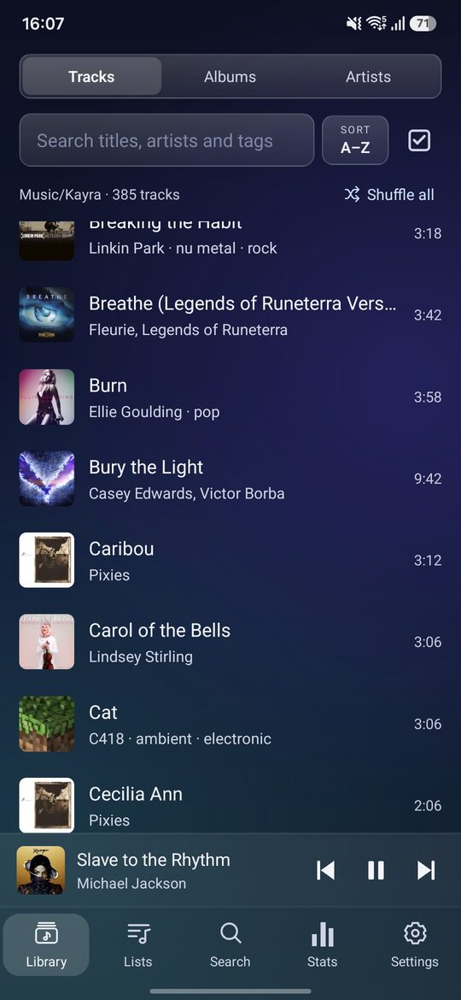
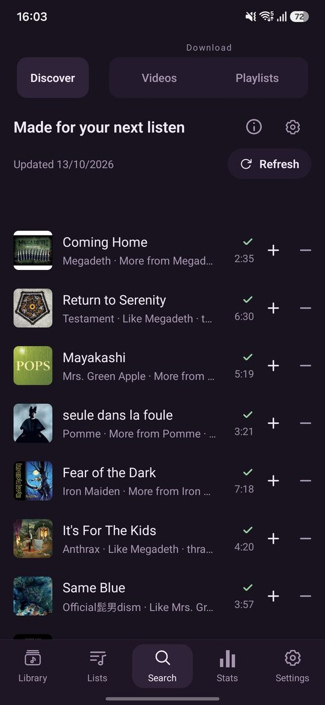
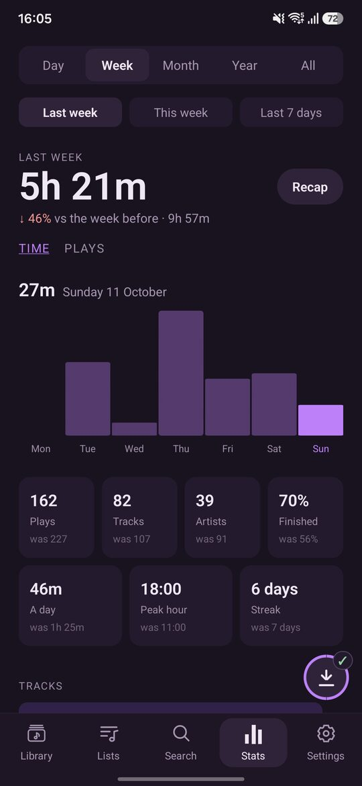
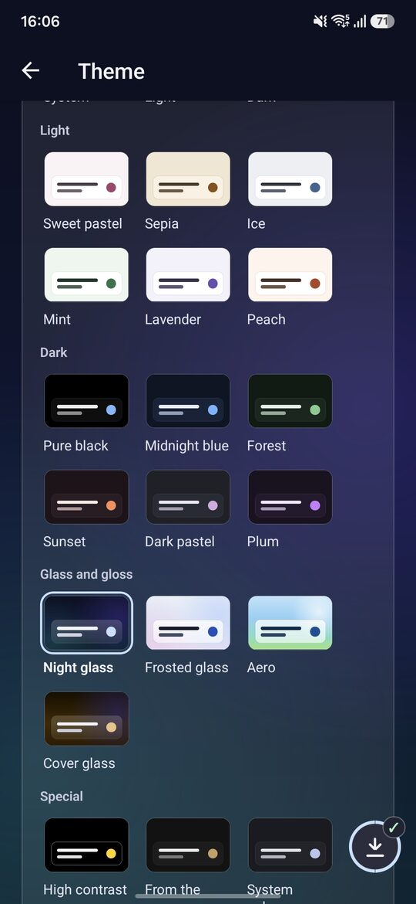
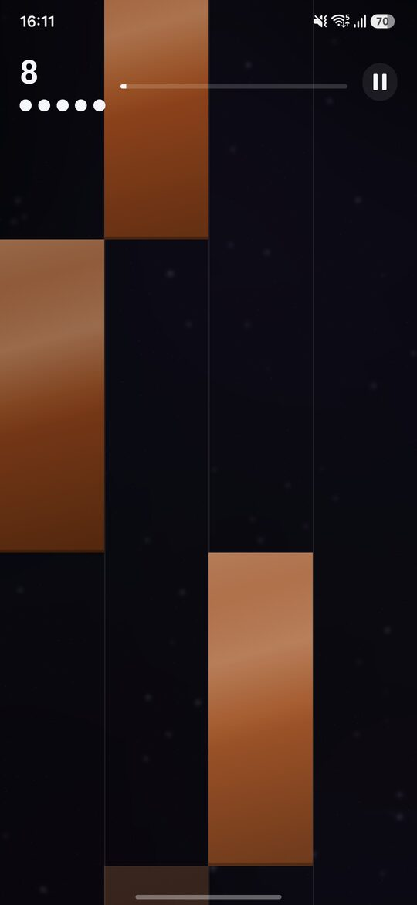
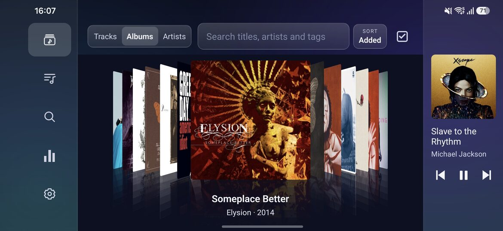
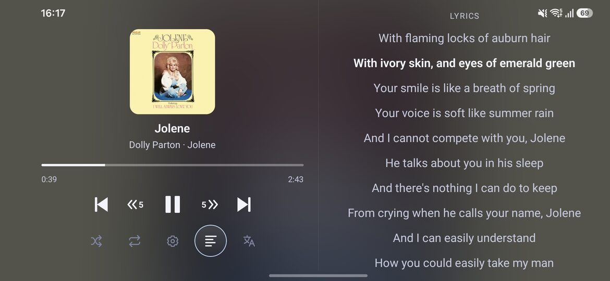

# Jukebox

A music player for Android that plays the files already on your phone.

No account needed, no server, no ads, no tracking. Your library, your listening
history and your stats stay on the device, unless you choose to connect
ListenBrainz and switch sending on. It is free software (GPL-3.0-or-later), and
it comes with a rhythm game built out of your own songs, because why not.

<p>
  
  
  
  
  
  
</p>
<p>
  
  
</p>

## Install

Jukebox is not on Google Play. It runs on Android 10 or newer, on a 64-bit ARM
phone, which is nearly every phone made in the last several years.

**With Obtainium**, which installs an app from its releases and tells you when
there is a newer one:

1. Install [Obtainium](https://obtainium.imranr.dev/).
2. In Obtainium, choose *Add app* and paste this address:

   ```
   https://github.com/Kayra5138/JukeboxAndroid
   ```

3. Press *Add*, then *Install*.

A newer release shows up in Obtainium by itself from then on, and installs over
the one you have with your library, lists and history as they were.

If Obtainium is already on the phone you are reading this on,
[this link adds Jukebox in one tap][obtainium]. It goes through Obtainium's
own redirect page, which is not Jukebox's and carries that site's analytics;
the three steps above reach the same place without it.

**By hand**: download the `.apk` from the
[latest release](https://github.com/Kayra5138/JukeboxAndroid/releases/latest)
and open it. Android asks once whether your browser or file manager may
install apps. To update, do the same with a newer release.

Every release is signed with the same key, so one installs over another
whichever way it was fetched. A copy you built yourself is signed with your
own key and will not: uninstall first if you switch (see [Building](#building)).

[obtainium]: https://apps.obtainium.imranr.dev/redirect?r=obtainium://app/%7B%22id%22%3A%22Kayra5138.Jukebox%22%2C%22url%22%3A%22https%3A%2F%2Fgithub.com%2FKayra5138%2FJukeboxAndroid%22%2C%22author%22%3A%22Kayra5138%22%2C%22name%22%3A%22Jukebox%22%7D

## Features

### Library and playback

- Pick a folder in Settings and Jukebox plays everything under it, subfolders
  included.
- Leave folders out (voice notes, call recordings, ringtones) and hide files
  shorter than 10, 30 or 60 seconds. Nothing is deleted, and a folder switched
  back on comes back with its history.
- Browse by track or by album. Sort by name, date added or most played, and
  search as you type.
- Or by artist, where a song by two artists is under both, or by the folders
  the files are kept in. Settings chooses which of the four views are offered,
  and each keeps its own sort order.
- Swipe a track right to play it next, left to add it to the end of the queue.
- Long-press a track for the full menu: play next, add to queue, go to album,
  add to a list, piano tiles, view & edit details, delete from the phone. The
  same menu opens on an album, artist, folder or list page and in the queue.
- Select several tracks at once to queue them, add them to a list, tag them,
  write their details into the files or delete them. In the album, artist and
  folder views a tick takes the whole group, and shows a dash when only part
  of it is chosen.
- **More…** on a selection, here and on the Tags screen, offers every edit a
  single track has, for all of them at once: look up details, covers only or
  lyrics; edit artist, album artist, album and year together (an empty box
  leaves each track as it is, a tick under it clears it on all); add or remove
  a tag; choose one cover; write to files; reset; delete.
- **Copies of the same song** are found: files whose names or tags say the
  same song and whose lengths agree to two seconds. A screen lists them with
  the copy to keep suggested (most listens first), moves each copy's history
  to it, and deletes the rest with one confirmation from Android.
- Search finds the tracks no artist was named for by "Unknown artist", to
  select and fix them at once.
- Albums, lists, artists and folders open with **Play**, **Shuffle** and
  **Add to queue** side by side.
- In the player, the artist's name and the album under the title open that
  artist and that record.
- A queue you can reorder, trim and jump around in.
- **What a tap plays** is yours to choose: the rest of the list (as it always
  was), the rest of it shuffled, similar songs, or only that song. On Tracks
  and in search results, and on albums and lists too if you say so. Similar
  songs are a batch picked at once from your library, Discover or both, as
  you set; after them the queue goes on as **Keep playing similar songs**
  says. Where too little is known about a song (no tags, no artist even in its
  file name) the batch is filled from your library at random, and says so.
  Any song's menu has **Play with similar songs** and **Play only this** for
  once.
- **Keep playing similar songs** when the queue runs out, from your library,
  new songs from Discover, or both mixed (off unless you choose). They are
  added a few songs early, so crossfade and the lock screen work as for any
  queue, under a heading of their own that one tap clears; what you add goes
  above them.
- A button on the player puts the playing song into a list in two taps.
- Repeat off, one or all.
- Jump back and forward by 5, 10, 15, 30 or 60 seconds (your pick).
- Speed and pitch sliders that work independently: slow a song down without
  dropping its pitch, or shift the pitch in semitones at normal speed.
- A sleep timer: 15 to 90 minutes or a number you type, or "at the end of
  this track". It can let the current track finish, the last half minute
  fades out, and it runs in the playback service, so it works with the app
  closed and the screen off.
- Deleting a track goes through Android's own confirmation, and so does
  writing details into a file, so the app never needs standing write access to
  your storage.

### A shuffle that feels random

- A fair shuffle puts three songs by the same artist in a row more often than
  you would expect, and it feels broken when it does.
- Jukebox shuffles each artist's tracks, then deals them out evenly across the
  queue. Two songs by one artist landing together stops being a matter of luck.
- 3,000 tracks shuffle in under a millisecond.

### Sound

- Equalizer: the app's own, the same on every phone. Up to twelve bands, each
  a peak or a shelf with its own frequency, gain and Q, a curve that shows what
  they add up to, a preamp that makes room for the boosts, and presets you can
  keep. Imports AutoEQ's headphone corrections (`ParametricEQ.txt`), pasted or
  from a file. Plus the phone's bass boost, surround and loudness.
- Real crossfade. A second player carries the tail of the outgoing track,
  started early and in silence so that the overlap begins without a gap.
  Separate lengths for a track ending, a skip, a pause and a seek.
- Stereo effects: width, balance, channel swap, headphone crossfeed, slow
  rotation ("8D") and a preamp.
- One-tap presets: Mono, Wide, Headphones, 8D, Karaoke-ish.
- Voice effects: Robot, Vintage, Swirl, Chipmunk, More chipmunk.
- Presets and voices are one tap away in the player's own settings sheet. The
  fine-tuning sliders live on their own screen.
- Even loudness (ReplayGain): a switch in Settings brings every track to
  -18 LUFS. A file's own ReplayGain or R128 tags are used where it has them;
  anything else, downloads included, is measured on the phone once (EBU R 128)
  and remembered. An album played in order keeps one gain. Nothing is turned up
  past a decibel under clipping.

### Lyrics

<p align="center">
  
</p>

- Read from the song itself first: lyrics kept in the file's tags (ID3,
  Vorbis/FLAC, MP4, APE; timed or plain), or a `.lrc` of the same name beside
  it. Android shows an app only audio files, so `.lrc` files are read from
  folders you grant once in Settings → Player. Nothing local is sent anywhere.
- Otherwise fetched from LRCLIB, synced line by line when a timed version
  exists. Each set of lyrics says where it came from.
- On-device translation with Bergamot, the engine behind Firefox Translations.
  Models come from Mozilla. No account, no key.
- A song in two languages is translated as two: a Japanese song with an
  English hook has each part put through its own model, and the lines already
  in your language are left alone.
- Romanised Japanese cannot be translated as it stands, so the same song's
  words in the original writing are looked for on LRCLIB and translated
  instead, line against line.
- Translations are into English unless Settings says another language. Any
  other goes through English and needs a second model.
- Fix things by hand: nudge the timing in quarter-second steps, search the
  catalogue yourself, or paste your own lyrics.
- The stored lyrics are editable where they stand. Fix one wrong line without
  pasting the whole song again.

### Tags and metadata

- One lookup against MusicBrainz and iTunes fills in artist, album, year, cover
  and track number for files that came without them.
- Tracks get an ordered list of tags instead of a single genre.
- Tags are filtered against MusicBrainz's genre vocabulary (2,188 entries,
  bundled), so `seen live` never shows up in your stats.
- Songs with more than one artist are found too. `Eminem, Rihanna`,
  `Eminem feat. Rihanna` and a guest left in the title are searched name by
  name.
- What a video's title says about the upload is left out of every search:
  `(Official Video)`, `(Explicit)`, `【MV】`, `- Official Audio`, `| Lyrics`, a
  bare `Official Music Video` at the end, and the same in French, Spanish,
  Italian, German and Turkish. `(Official Live Video)` is still searched as
  the live recording.
- Emoji that Android's scanner turned into question marks in a title, artist
  or album are put back from the file's own name.
- Everything is editable, and a later lookup never overwrites what you typed.
- **A cover is looked for once an album, and the album wears it.** A track
  that needs one takes the cover another track of its album already has,
  without asking anybody, whenever a cover arrives: a lookup, one chosen by
  hand, a new download joining the album, or the picture inside one of its
  files. Only to fill a gap, never over a cover you chose, and never back
  onto one you took off. An album shows the cover most of its tracks wear,
  so an empty first track no longer leaves the whole record blank.
- **Look up this album**, from an album's page or menu, finds the release on
  MusicBrainz once and matches its track list to your files, with one cover
  search for the record: a dozen tracks in about five requests. **Choose album
  cover** puts one picture on every track.
- **Album artist.** Read from the files, filled in by lookups, editable and
  written back. Two records of one name by different artists are two albums;
  a guest on one track, or a compilation ("Various Artists"), stays one.
- **Look up missing** on the Tags screen asks MusicBrainz and Apple side by
  side, each at its own polite pace, and fills the rows in as answers arrive.
  A track with nothing missing costs nothing. If one service cannot be reached
  the other finishes and the screen says which was given up on.
- **Lookups go on behind the screen.** A run over details, covers or lyrics
  keeps going with the app in the background or the phone locked, with a
  notification that shows how far it has got and has its own Stop.
- **View & edit details** is one page with three tabs: General, Tags, Lyrics.
- General edits title, artist, album artist, album, year, track and disc
  number, and the cover, which you can pick from your gallery.
- Each tab has its own **Look up**. In General and Tags it only fills the form
  in: nothing is kept until you press Save.
- `Rock` and `rock` are the same tag.
- All of this is kept in the app and your files are left as they are, unless
  you press **Write to file**: on the General tab for one song, or **Write to
  files** in the Library's selection for many. It never happens by itself.
- Write to file puts what the app shows into the file: title, artist, album
  artist, album, year, track and disc number, the first tag as the genre, and a cover saved in
  the app. MP3 (ID3v2) and FLAC only, on Android 11 or newer. Android asks
  before anything is changed, and lyrics are not written.
- The file itself is not worked on. A copy is tagged with TagLib and read back,
  its sound is compared byte for byte with the original's, and only then is it
  written over the original. A failure before that leaves the file untouched.
- A v2.3 tag stays v2.3, for the car stereos that read nothing newer. Other
  tags, comments, ReplayGain and extra pictures in the file are kept.

### Lists and albums

- Lists ordered by hand, with a cover of your choice: a grid of four, one
  track's cover, or a picture from your phone.
- Make a list from a tag in two ways. A *following* list always mirrors the
  tag. A *copy* is yours to rearrange.
- **M3U in and out.** Bring in playlists from another player or a computer
  (`.m3u`, `.m3u8`; Windows paths, `file://` addresses and old Turkish,
  Western and Cyrillic encodings included), matched to your files by path, by
  file name or by the artist and title the file names. Write one list, or all
  of them into a folder, as `.m3u8` with the phone's paths or paths a computer
  can follow. A list holds each song once, so repeats in a file are folded.
- Suggestions for what else belongs in a list, based on its tags. Rare tags
  weigh more than common ones.
- Four automatic lists built from your history: Most played, New this month,
  Forgotten and Skipped most.
- A list keeps a song whose file is not in the library just now (the folder
  narrowed, a card out) and says how many are away. Only erasing the file
  takes it off.
- Albums are assembled from your tags. In landscape you can flick through them
  as a rack of sleeves instead of a list; the one in front opens into the
  record's full list and closes back to where the rack was.
- **Find the rest of this album.** Hold an album, or open it, and the app
  lists the whole record: what you have, and what is missing, ticked. One
  button fetches the missing tracks, and each lands in the album in its
  place, with the album's cover. The track list comes from MusicBrainz, which
  picks the pressing that best covers what you already have, so a record of
  twelve is not said to be missing the nine extras of a box set. Where
  MusicBrainz has no answer the album is looked for on YouTube, and taken
  only when it can be shown to be the same record. Either source can be
  switched to by hand.
- The same screen puts the tracks you already have in the record's order,
  where they had no number or the wrong one, and offers to undo it.

### Stats and recap

- Every listen past 30 seconds is recorded. So is every skip.
- Stats by day, week, month, year or all time, compared with the period before.
- Each of those read three ways: yesterday, today or the last 24 hours; last
  week, this week or the last 7 days; and so for a month and a year.
- A chart you can scrub, with the top tracks, artists and genres behind it.
- A song by two artists counts for both. `Eminem, Rihanna` is never an artist
  of its own, and `Earth, Wind & Fire` is never three.
- Recap cards you can save or share. Artist photos come from Wikimedia Commons
  and the credit is printed on the card.

### ListenBrainz (experimental)

- Optional, and off until you set it up. It is the one thing in the app that
  needs an account: paste your ListenBrainz user token at the foot of
  Settings, under Experimental. With no token nothing is ever sent.
- ListenBrainz only takes listens for an account with a verified e-mail
  address. If it refuses them, the card says what it said, and the token is
  kept.
- **Send what I listen to** is a separate switch, off even after a token is
  entered. Once on, every listen the app records from then on is sent: the
  app's own rule, anything past 30 seconds.
- **Send past listens** uploads the history from before, when you ask. It
  shows how many are left, can be stopped, and carries on from where it was.
- Listens go under the title, artist and album the app shows, corrections
  included. A track with no artist is left out, and the card says how many.
- A listen recorded offline waits and is sent later. Sending happens while the
  app is open; there is no background service for it.
- The token stays on the phone. It is never written to a backup or read from
  one, and Settings shows the account name instead of it.
- After restoring a backup nothing counts as sent, so sending past listens
  sends them all again. ListenBrainz recognises the ones it has and drops them.
- **Disconnect** forgets the token and what was sent. Nothing on ListenBrainz
  is removed.
- What was sent can be looked at on your ListenBrainz page; the card links to
  it.

### Discover

- A list of songs you do not have, made from what you have been playing:
  about half from artists you already listen to, half from new ones, with no
  more than two songs by any artist.
- The taste it works from is on the phone, your own plays and skips, and
  never leaves it. ListenBrainz, Deezer and MusicBrainz are asked only about
  artists and songs: who is near whom, and what an artist is best known
  for. An artist both ListenBrainz and Deezer name counts for more, and the
  artists you play most lead the most of the list. Either may be out of
  reach and the list is still made from the other.
- Every row says why the song is there: *More from …*, *Because you play …*,
  *Like … · dream pop*.
- **Tap a song and it plays.** It goes to the front of the download queue
  and starts when it is in; the next few are kept ready, on Wi-Fi unless you
  say otherwise, so most taps play at once. The window follows the song
  that is playing. A song is fetched as the audio YouTube has, without
  conversion.
- **Thirty seconds while it arrives.** A song that is not ready yet plays
  Deezer's preview of it for the few seconds the download takes, then the
  whole song takes over from its start. A preview is in no queue, no
  history and no scrobble. It can be turned off.
- **+** keeps a song in your library, with the plays it has had; **−** turns
  it away. Swipe a row either way, or use the buttons, on the row, in the
  player and on the bar. Another song takes its place at the end of the
  list, which never reorders under your finger.
- **What you do changes what comes next.** Turning a song away counts
  against its artist for six months, keeping one counts for it, and an
  artist can be turned away altogether (and let back in, in the settings).
- **How well known** a song is does not matter unless you ask: there is a
  setting for mostly well-known songs, or mostly lesser-known ones.
- 10 to 40 songs. Refresh by hand, or on a schedule you pick. A new list
  arrives when its first few songs are ready, and songs you did not keep stay
  away: three months if you heard them, two weeks if you did not.
- No live takes, and no remaster of a song you already have. A song with no
  studio recording to be found gives up its place.
- **The video has to be the song.** A video is taken by its name; on its
  length only when its title is in another writing (いってらっしゃい for
  Itterasshai), never when its title, readable, is another song. A download
  saved under a name its video does not say is caught: Discover's own are
  fetched again, and any already in your library are listed to be renamed,
  deleted or marked right.

### Downloads

- The Search tab finds songs on YouTube by name, by link or by playlist.
- Save as MP3 or keep the original audio.
- A playlist becomes a local list with the same name, in the same order and
  without duplicates.
- Downloads keep going when you leave the app, and unfinished ones are picked
  up again when you come back.
- **Nothing twice.** Importing a playlist leaves out what the library
  already has, even files copied from a computer: by the video id yt-dlp puts
  in a file's name, or by title and length; a search result already in the
  library says so.
- **One queue.** Everything fetched from YouTube waits in one line and is
  fetched one thing at a time: what you search for, a playlist, the rest of
  an album, what Discover wants. A search you type goes at once and the queue
  waits for it. What Discover fetches by itself always goes last, and only
  when nothing you asked for is waiting.
- **Downloads**, in Settings, shows the line: what is being fetched, what is
  next, and what has been. Drag to reorder, send one to the front, cancel,
  try a failed one again, pause the whole queue, or clear what is finished,
  which removes nothing from the phone.
- **A download that fails is tried once more by itself**, after a short
  wait, when trying again could help: the network, a time-out, the app being
  closed in the middle. The queue says so on the row.
- **A floating button**, off unless you switch it on, appears while something
  is being fetched and says what, and how much is left.
- **yt-dlp can be brought up to date from inside the app.** When YouTube
  changes, an old yt-dlp begins to fail. Downloads names the version in use,
  says when there is a newer one, and fetches it when you ask: from yt-dlp's
  own release, checked against that release's sums, and tried before it is
  trusted. The copy the app came with can be gone back to.

### Piano Tiles

Long-press any track and choose **Play piano tiles**. The game is generated
from the song itself.

- **Charts from audio.** The song is analysed on the device, with no account
  and no server.
- **Keys land on the beat.** The song's pulse is followed from start to finish,
  so the board stays in time even when the band speeds up or drags.
- **Keys follow the tune.** The melody is tracked and its pitch decides the
  column: low notes on the left, high notes on the right. Where nobody is
  singing or playing a tune, the drums and bass decide instead.
- **A chorus is the same keys every time.** Bars that are the same music are
  found by ear (harmony, sound and rhythm) and given one pattern, rests and
  holds included. What you learned the first time still works the third.
- **A ladder of keys.** Every key has the same height and each one starts where
  the last ended. Long notes become hold keys.
- **Holds are worth their length.** One point per row, and a hold counts as
  kept at 60% so your hand is free before the next key.
- **It breathes with the music.** Rows stay empty where the song is silent
  (30 dB under its usual level for 1.5 s) and where it eases off.
- **Four difficulties: Easy, Normal, Hard, Harder.** Each one runs at the same
  pace on every song, within about a fifth, whatever the tempo. A bar is always
  cut into a whole number of keys.
- **Two-finger notes** on Hard and Harder, on the moments the music hits
  hardest, never in neighbouring columns.
- **Five lives.** Fifty clean keys in a row give one back.
- **Sounds that cannot clash with the song.** Every effect is shaped noise with
  no pitch: tap, empty tap, missed key, a soft breath while holding, a rising
  sweep for a completed hold.
- **Colours from the album cover**, one shade per column.
- **Latency offset** for Bluetooth headphones.
- **Fast to start.** MP3s are decoded inside the app with minimp3, so a chart
  takes about two seconds instead of six to ten. Charts are cached after that.
- The song starts and stops with the run, and Back pauses instead of quitting.
- **An ending you can read.** The board stops and stays, and the score fades in
  over it. Lose, and the move that did it is marked in red: the key that got
  past is brought back to the foot of its column, an empty tap gets a mark
  under your finger. Reach the end of the song and confetti flies.

### Language and looks

- Ten languages: English, Turkish, German, Spanish, French, Italian,
  Brazilian Portuguese, Russian, Japanese and Simplified Chinese. The first
  start asks which, with the phone's own already picked, and Settings changes
  it later. The notification, the widget and Android Auto follow the same
  choice. Everything but English was translated by AI; see
  [Development](#development) if a line reads wrong.
- **A short setup on the first start**: the language, the look, Discover,
  what a tap on a song plays and whether to keep playing similar songs, each
  step skippable. Somebody
  updating is shown, once, only the steps added since they last saw it.
- **The first start again**, from the foot of Settings: the setup, the offer
  to find covers and the tips, as on the day it was installed, with your
  music, lists and settings left as they are.
- **Tabs you do not use can go.** Lists, Search and Stats can each be taken
  off the bar in Settings → Look; Library and Settings stay.
- **Your own pair for day and night.** Following the phone goes between two
  themes, and you choose which: any theme for its light mode, any for its
  dark.
- **A different theme each time**, if you like: tick the themes you want and
  the app opens in one of them at random, never the one it was last in.
- Twenty-two themes, or follow the phone between light and dark. Six light
  ones (Sweet pastel, Sepia, Ice, Mint, Lavender, Peach), six dark (Pure
  black for OLED, Midnight blue, Forest, Sunset, Dark pastel, Plum), four of
  glass and a high-contrast one.
- **Glass both ways.** In the glass themes a screen opens over the one it
  came from, which shows through out of focus, and lists scroll under the top
  bar, the tab bar and the mini player and show through them, out of focus on
  Android 12 and newer; the bars are dense enough that their words stay
  readable whatever passes under.
- **Glass and gloss.** Night glass and Frosted glass are panes over a slow
  sky, by night and by day; Aero is the polished look of an old desktop, sky
  over grass with a band of gloss on everything; Cover glass is the night
  glass over a sky made from the record that is playing. Cards let the page
  through, what is behind a sheet or a dialog goes out of focus while it is
  open (Android 12 and newer; a thicker dim before that), and the player
  wears its cover, blurred, as its page.
- **Custom** is a theme of your own from two or three colours: the page, the
  accent, and the cards if you want to choose them. Everything else is
  worked out, the text always so that it can be read; a colour that could
  not be read where it is used is nudged, and the editor says so.
- **High contrast** is for seeing with, not for looking at: black, white and
  yellow, every card, chip and field with a line round it, and nothing told
  apart by a shade of grey.
- **From the cover** takes its accent from the record that is playing, and
  keeps the usual one for a cover with no colour in it.
- **System colours** uses the palette Android 12 and newer make from your
  wallpaper.
- The game and the recap cards keep their own colours whatever the theme.
- The splash screen follows the phone's light or dark mode. It is drawn before
  the app has started, so it cannot know a theme chosen inside it.

### Around the phone

- Home-screen widgets and a media notification, all with working controls, on
  a gradient made from the cover's colours:
  - **Jukebox**, one row tall;
  - **Now playing** (4×2): a large cover, a progress bar, shuffle and repeat;
  - **Up next** (4×4): the same with the next songs in the queue, each
    playable with a tap;
  - **Shuffle** (2×1): Shuffle all and Shuffle recent in one tap.

  The now-playing ones change layout as they are resized, and the cover opens
  the player.
- Three dots at the end of every row of tracks open its menu, as a long press
  does; Settings → Look can take them away.
- Pause, then swipe the notification away to close the music.
- Playback keeps going with the app closed.
- A landscape layout: tabs move to a rail on the left, the player to a panel on
  the right.
- A "hold the decoration still" switch for older phones. It turns off the
  decorative animations and leaves the game playable. Android's own "Remove
  animations" does the same.
- Usable with TalkBack: every control is named, sliders and the scrubber move
  by swipe, queue and list rows have move actions, and progress is read out.
  Rows grow with large text instead of cutting it off.

### Android Auto

- Four tabs: Home, Tracks, Albums, Lists. Everything is cover tiles.
- Home starts with Continue, Shuffle recent and Shuffle all, then what you
  played lately.
- Each shelf has a Sort tile at its head: by name, artist, recently added,
  most played or recently played.
- Search works typed or spoken.
- Names and covers are the ones the phone shows, corrections included.

### Your data

- **Export everything** in Settings writes one zip: listening history, skips,
  lists, tags, track details, lyrics and translations, covers, settings and the
  sound setup.
- Not in it: the music itself, the download history, the library folder and
  anything about a ListenBrainz connection, its token least of all.
- **Import** reads that zip on any phone. Songs are found again by file name,
  then by title, artist and length, because a song's id differs between phones.
- Before anything is written you see what is in the backup and how many of its
  songs are on this phone.
- If the phone already holds data you choose: **Merge** adds the backup to what
  is here and removes nothing, **Replace** swaps it in.
- Merging the same backup twice adds nothing. A listen is counted once.
- The write is all or nothing. A failed import leaves the phone as it was.
- A file that is moved, or given a new id by Android, keeps its history, tags,
  lyrics and places in lists. Where size and length agree it is followed
  without a word; where it is less sure, **Same song?** appears in Settings
  and asks.

## What touches the network

Playback, the library, stats, lists and the game work fully offline. These are
the only things that go out. None of them needs an account or an API key, except
the last: sending your listens to ListenBrainz needs your token for it, and is
the only one that sends anything about you.

| When you | It talks to |
| --- | --- |
| Look up a track's details | MusicBrainz, iTunes Search |
| Find the rest of an album | MusicBrainz, YouTube (the track list, where MusicBrainz has none, and the songs) |
| Fetch lyrics | LRCLIB |
| Translate lyrics | Mozilla (model download, once per language); LRCLIB (the original writing of romanised lyrics) |
| Open a recap | MusicBrainz, Wikimedia Commons (artist photos) |
| Ask for recommendations | ListenBrainz, Deezer and MusicBrainz (artists and songs; nothing about you), Cover Art Archive and Deezer (covers), YouTube (the songs) |
| Tap a recommendation that is not ready | Deezer (a thirty-second preview, unless turned off) |
| Keep playing new songs when the queue runs out (if chosen) | The same as Discover: ListenBrainz, Deezer and MusicBrainz about artists, YouTube for the songs |
| Open Downloads, or ask for a download | GitHub (whether there is a newer yt-dlp; at most once a day, and it can be turned off) |
| Press Update on the Downloads screen | GitHub (the newer yt-dlp, about 3 MB) |
| Use the Search tab | YouTube |
| Open the app, at most once a day | GitHub (whether there is a newer Jukebox; it can be turned off under Settings → Your data) |
| Press Open GitHub on Report a problem | GitHub, in your browser (the report you have just read; nothing is sent otherwise) |
| Browse in the car | iTunes (a cover not saved yet, fetched once) |
| Connect ListenBrainz and switch sending on | ListenBrainz (your listens) |

## Requirements

To build it. To run it, see [Install](#install).

- Android 10 (API 29) or newer, 64-bit ARM
- Node 22.6+ (the tests run TypeScript directly through Node's type stripping)
- JDK 17
- Android SDK, plus the NDK and CMake 3.22.1 from the SDK manager

## Building

```bash
npm install
npm test                 # 2,262 tests, pure logic
npx tsc --noEmit         # typecheck

npx expo prebuild --platform android

cd android
./gradlew :jukebox-audio:testDebugUnitTest   # 473 more, in Kotlin
./gradlew :app:assembleRelease
adb install -r app/build/outputs/apk/release/app-release.apk
```

Good to know:

- `android/` is generated and not in the repository. Run `prebuild` once in a
  fresh checkout, and again whenever `app.json` or a config plugin changes.
- The first build compiles the translation engine from source: about 20 MB of
  C++ to fetch and roughly a minute to build. After that it is cached. TagLib
  is fetched and built the same way and adds a few seconds.
- `./gradlew :jukebox-audio:checkTagWriter` builds the tag writer for your
  computer and runs it over files made up for the purpose. It needs a desktop
  C++ compiler and zlib's headers, and no build depends on it.
- Builds are `arm64-v8a` only. The translation engine does not compile for
  32-bit ARM or x86, so the config plugin pins the architecture for you.
- Your own builds are signed with the debug keystore, which is fine for your
  own phone. The APKs on the Releases page are signed with a private key (see
  `scripts/release-apk.sh`), so Android will not install one over the other.
  Uninstall first if you switch.
- If an installed build runs stale JavaScript, clear the bundle cache:
  `rm -rf android/app/build/generated/assets/react`
- Icons are generated from `assets/source` by `scripts/icons.sh` (needs
  ImageMagick).
- `scripts/android-auto.sh` opens the Desktop Head Unit against your phone as a
  720p dashboard. `AUTO_SCREEN=small`, `1080p` or `wide` picks another screen.
- Android Auto hides sideloaded apps unless its "Unknown sources" developer
  switch is on. Installing with `adb install -r -i com.android.vending` gets
  your own build listed without it.

## Permissions

| Permission | Why |
| --- | --- |
| `READ_MEDIA_AUDIO` | Reading your music |
| `POST_NOTIFICATIONS` | The playback notification |
| `FOREGROUND_SERVICE`, `FOREGROUND_SERVICE_MEDIA_PLAYBACK` | Playing in the background |
| `FOREGROUND_SERVICE_DATA_SYNC` | Downloads and lookups that outlive the screen |
| `MODIFY_AUDIO_SETTINGS` | Attaching the bass boost, surround and loudness |
| `WAKE_LOCK` | Keeping the phone awake while music plays, a download runs or a lookup goes on |
| `INTERNET`, `ACCESS_NETWORK_STATE` | Lookups, lyrics, downloads, and telling "offline" from "failed" |
| `VIBRATE` | Haptics on swipes and in the game |

There is no permission to write to storage. Deleting a track, and writing
details into a file, each raise a system dialog that grants those files, that
once.

Two things are switched off on purpose: `SYSTEM_ALERT_WINDOW` is blocked (a
music player has no reason to draw over other apps), and `allowBackup` is
false, so your listening history cannot be pulled over `adb`. Getting it out is
your call: Settings, Export everything.

## Project layout

```
src/
  app/          screens, file-routed with expo-router
  components/   shared views
  screens/      the larger screens the routes point at
  screens/tiles/  the game's screen, in its parts
  lib/          everything that is not a view
  lib/i18n/     every word the app says, a file per area and per language
  lib/theme/    the colour tokens and the themes, one file each
  lib/tiles/    the game's rules: pure functions, fully tested
modules/jukebox-audio/
  android/      Kotlin: playback, library, downloads, effects, chart analysis
  android/src/main/res/   the native side's words, in each language
  android/src/main/cpp/   the in-app MP3 decoder (one C file) and the tag writer on TagLib
  src/          the module's TypeScript surface
assets/source/  the icon as drawn; every other size is generated
scripts/        icons, genre vocabulary refresh, release signing, Android Auto helper
```

## How it works

- **Stack:** Expo SDK 57, React Native 0.86 (new architecture, Hermes), React
  19, expo-router, Reanimated 4, expo-sqlite.
- **Playback** is a Media3 `MediaLibraryService` holding an `ExoPlayer` and the
  whole queue. The notification, the widget, the car and the app all talk to it
  through a `MediaController`. No JavaScript has to be running for music to
  play, which is why a media button still works after the app is gone.
- **The service never opens the app's database.** It reads with Android's
  SQLite, the app writes with expo-sqlite's own, and two copies of SQLite in
  one process cannot see each other's locks: one read from the service used to
  delete the write-ahead log under the app, and everything saved afterwards was
  lost at the next restart. The app now writes what the service needs into a
  small copy and hands it over by rename.
- **A crossfade is two players, and the second is put in step where nobody
  can hear it.** It is started three seconds before the overlap with its volume at
  nought, its position is compared with the main player's once both can be
  believed, and it is run a little fast or slow until they agree. At the
  overlap its volume comes up and the main player moves on. Started at the
  overlap instead, it took a quarter to half a second to make a sound, and
  that was a hole in every crossfade.
- **Loudness, the equalizer, the fade and the effects are stages of one audio
  chain** in that order, each player with its own, so the two halves of a
  crossfade keep their own levels.
- **The game borrows the player.** For a run the speed and pitch go to normal
  and the queue is set aside; both come back afterwards, and nothing played
  under a run counts as a listen.
- **Words and colours are tables.** A screen asks for a string by name and a
  colour by role. A language is a set of files the compiler checks against
  the English, and a theme is one file of colours, tested for contrast. A
  theme of glass is still that: its page, its sheen and its blur are said
  once beside its colours, and no screen asks whether it has them.
- **The media session is closed to strangers.** Only the app itself, the system
  and known browsers (Android Auto, Wear, Assistant, system UI, Bluetooth) may
  connect.
- **The game board** runs on the UI thread with Reanimated worklets. Tiles are
  moved with transforms only, so a frame never reaches layout.
- **The game clock never jumps.** When it disagrees with the audio it changes
  its rate by a bounded amount until they agree again. A position that jumps is
  a board that stutters.
- **Chart analysis** is Kotlin, in two passes. A short window finds the onsets
  and, from their autocorrelation, the song's smallest steady step; dynamic
  programming then lays a line on every step. A long window gives harmony,
  timbre and the melody (harmonic summation and a Viterbi path).
- **The board runs in grid time.** The chart says where each step really falls
  in the recording, and the board reads the player's position through that, so
  rows stay equal while the clock bends with the band.
- **One gate to YouTube.** Every call to the extractor passes through one
  gate on the phone, and jobs wait in one persisted list. A song can be
  queued by name: the phone keeps its place and its turn, and the choice of
  video stays with the one matcher there is, in JavaScript, asked through a
  long poll so that it works with the app behind another, where timers stop.
- **Tests cover logic, not UI:** calendar arithmetic for stats, tag weighting,
  the shuffle spread, lyric parsing, crossfade rules, backup merging, the game's
  rules. The Kotlin tests render audio buffers and measure what came out.
- **A backup is a zip** with one JSON document and the cover files. Merging is
  a pure function over two sets of tables, tested against a real SQLite, and
  the result goes in under a single transaction.
- **The translation engine, the MP3 decoder and the tag writer are built from
  source.** Bergamot, minimp3 and TagLib are fetched at pinned commits and
  rejected if their SHA-256 does not match. The downloader's FFmpeg and Python are the
  exception: they come prebuilt with its wrapper, pinned by version.

## Development

Jukebox is made by one person. The day-to-day work happens in a private
repository, and each release is published here as one commit holding that
release's code: the history here is a commit per version, not every change.

- **Bugs and ideas** are welcome as
  [issues](https://github.com/Kayra5138/JukeboxAndroid/issues). There is a
  form for each. Settings → Report a problem fills the bug form in for you
  with the version, the phone and the app's recent errors (scrubbed of names,
  paths and addresses), and shows all of it before anything is sent.
- **Translations.** English is written by hand. The other nine languages,
  Turkish included, were translated by AI and have not yet been checked by
  a native speaker; the app says so on its language screen. If a line
  reads wrong in yours, an issue saying where it is and how it should read is
  the most useful thing you can send. Each language is a folder under
  `src/lib/i18n/` and a `strings.xml` under
  `modules/jukebox-audio/android/src/main/res/values-*/`.
- **Code.** Pull requests are read, but because of how this repository is
  published they are not merged here. A change that is taken is applied by
  hand and arrives with the next release, credited in its notes. For anything
  bigger than a fix, an issue first saves both of us time.
- Before sending code, `npm test` and `npx tsc --noEmit` should pass; see
  [Building](#building) for the Kotlin tests.

## Licence

Copyright (C) 2026 Kayra5138. **GPL-3.0-or-later**, see [LICENSE](LICENSE).

- Copyleft on purpose: if you get the app you get the source, and whatever is
  built on it stays open.
- There is nothing proprietary in the build. Translation is Bergamot (MPL-2.0),
  language detection is `franc` (MIT), the MP3 decoder is minimp3 (CC0), and
  tags are written into files by TagLib (LGPL-2.1).
- Version 3 because Media3 and AndroidX are Apache-2.0, which is compatible
  with GPL-3.0 and not with GPL-2.0.
- The icon drawings in `assets/source` are mine, under the same licence.
- Every third-party component is listed in
  [THIRD_PARTY_NOTICES.md](THIRD_PARTY_NOTICES.md).

Jukebox is not affiliated with or endorsed by any service it talks to. YouTube
is a trademark of Google LLC. Firefox and Bergamot are Mozilla projects.
MusicBrainz, ListenBrainz and the Cover Art Archive are MetaBrainz Foundation
projects. What you do with a downloader is between you and whoever holds the
rights to what you point it at.
